# 🚗 Locaro: Sistema de Aluguel de Carros

> [!NOTE]
> Sistema web para **gestão de aluguéis de automóveis com análise financeira**: clientes fazem, modificam e cancelam pedidos pela internet; agentes (empresas e bancos) avaliam a capacidade financeira do cliente, aprovam os pedidos e executam os contratos, com a possibilidade de crédito bancário.

<table>
  <tr>
    <td width="800px">
      <div align="justify">
        O <b>Locaro</b> foi desenvolvido no <b>Laboratório 02</b> da disciplina <i>Desenvolvimento de Interfaces e Aplicações Web (DIAW)</i> do curso de <b>Engenharia de Software da PUC Minas</b>. O sistema conecta <b>clientes</b>, que solicitam o aluguel de um automóvel informando seus rendimentos, a <b>agentes</b> (empresas locadoras e bancos), que analisam o pedido do ponto de vista financeiro e, com parecer positivo, executam o contrato. O projeto segue a <b>arquitetura MVC</b>, com back-end em <b>Spring Boot</b>, front-end em <b>React + Vite</b> e banco de dados <b>PostgreSQL no Supabase</b>, e foi construído a partir de uma modelagem UML (casos de uso, classes e pacotes) que evoluiu junto com o código.
      </div>
    </td>
    <td>
      <div>
        
      </div>
    </td>
  </tr>
</table>

---

## 🚧 Status do Projeto


---

## 📚 Índice
- [Links Úteis](#-links-úteis)
- [Sobre o Projeto](#-sobre-o-projeto)
- [Funcionalidades Principais](#-funcionalidades-principais)
- [Tecnologias Utilizadas](#-tecnologias-utilizadas)
- [Arquitetura](#-arquitetura)
  - [Diagramas UML](#diagramas-uml)
  - [API REST](#api-rest)
- [Instalação e Execução](#-instalação-e-execução)
  - [Pré-requisitos](#pré-requisitos)
  - [Variáveis de Ambiente](#-variáveis-de-ambiente)
  - [Instalação de Dependências](#-instalação-de-dependências)
  - [Banco de Dados (Supabase)](#-banco-de-dados-supabase)
  - [Como Executar a Aplicação](#-como-executar-a-aplicação)
  - [Usuários de Teste](#-usuários-de-teste)
- [Estrutura de Pastas](#-estrutura-de-pastas)
- [Demonstração](#-demonstração)
- [Testes](#-testes)
- [Documentações utilizadas](#-documentações-utilizadas)
- [Autores](#-autores)
- [Contribuição](#-contribuição)
- [Agradecimentos](#-agradecimentos)
- [Licença](#-licença)

---

## 🔗 Links Úteis
* 📖 **Histórias de usuário:** [docs/historias-usuario.md](docs/historias-usuario.md)
  > 📚 As 20 histórias levantadas, com critérios de aceitação e o escopo implementado em cada uma.
* 🧭 **User flow:** [docs/user-flow/user-flow.md](docs/user-flow/user-flow.md)
  > 🗺️ Fluxos de navegação do cliente e do agente, e o ciclo de vida do pedido (Mermaid).
* 📐 **Diagramas UML e histórico de versões:** [docs/README.md](docs/README.md)
  > 🧩 Casos de uso, classes e pacotes nas versões v1 (modelagem inicial) e v2 (alinhada ao código final).

---

## 📝 Sobre o Projeto

**Qual problema resolve.** Alugar um carro com condições financeiras diferenciadas (por exemplo, com crédito bancário) exige que alguém analise a renda de quem aluga antes de fechar o contrato. O Locaro organiza esse processo pela internet: o cliente faz o pedido informando seus rendimentos, e os agentes avaliam, aprovam e formalizam o contrato, tudo num só lugar e com o status do pedido sempre visível.

**Como funciona.**
1. O **cliente** se cadastra com seus dados de identificação (RG, CPF, nome, endereço), profissão e até **3 rendimentos** (entidade empregadora + valor).
2. Ele escolhe um automóvel e o período, e o pedido entra **em análise**.
3. Um **agente** (empresa ou banco) consulta os dados financeiros do cliente e **aprova ou reprova** o pedido.
4. Com o pedido aprovado, o agente **executa o contrato** e define a quem o automóvel fica registrado: cliente, empresa ou banco.
5. Se o agente for um **banco**, ele pode **conceder um contrato de crédito** junto (valor, juros e prazo).
6. Enquanto o pedido está em análise, o cliente pode **modificá-lo**; até a aprovação, pode **cancelá-lo**.

**Contexto.** Projeto acadêmico (Laboratório 02, DIAW, PUC Minas). A avaliação considera a adequação aos requisitos, o **alinhamento entre o modelo (classes e arquitetura) e o código** e a **atualização dos modelos** ao longo do projeto. Por isso, a documentação de modelagem está versionada em [`docs/`](docs/README.md).

---

## ✨ Funcionalidades Principais

Os códigos entre parênteses referenciam as [histórias de usuário](docs/historias-usuario.md).

**🔐 Autenticação e acesso**
- Cadastro de cliente com validação de CPF e de unicidade (US01).
- Login com usuário e senha; o sistema só pode ser usado após autenticação (US03).
- Rotas protegidas por perfil: cliente e agente só acessam as próprias funcionalidades (US03).
- Logout (US04).

**👤 Cliente**
- Consultar, atualizar e excluir a própria conta (US05, US06, US08).
- Gerenciar até 3 rendimentos, com renda total calculada (US07).
- Criar pedido escolhendo automóvel e período, com verificação de disponibilidade (US09).
- Acompanhar os pedidos com filtros (em aberto, contratados, encerrados) e um painel de detalhe com a linha do tempo do pedido (US10).
- Modificar pedidos em análise e cancelar pedidos em análise ou aprovados (US11, US12).

**🏢 Agente (empresa ou banco)**
- Listar pedidos por status: em análise, aprovados, contratados e reprovados (US13).
- Consultar os dados financeiros do cliente: profissão, rendimentos e renda total (US14).
- Modificar o automóvel ou o período de pedidos em análise (US15).
- Aprovar ou reprovar pedidos, com registro de quem avaliou (US16).
- Executar o contrato de pedidos aprovados, definindo o proprietário do automóvel (US17).

**🏦 Banco**
- Conceder contrato de crédito (valor, juros ao mês e prazo) ao executar o contrato (US18).

**Fora do escopo desta versão:** telas de cadastro de agentes e de automóveis (US02, US19 e US20). Agentes e automóveis são inseridos via script de seed (veja [Banco de Dados](#-banco-de-dados-supabase)).

---

## 🛠 Tecnologias Utilizadas

### 💻 Front-end

* **Biblioteca:** React 19
* **Linguagem:** JavaScript (ES2022+)
* **Roteamento:** React Router 7
* **Estilização:** CSS puro com variáveis (identidade visual *glassmorphism*, com suporte a alto contraste e transparência reduzida)
* **Gerenciamento de Estado:** Context API (sessão do usuário)
* **Build Tool:** Vite 8
* **Lint:** Oxlint

### 🖥️ Back-end

* **Linguagem:** Java 25 (JDK 25)
* **Framework:** Spring Boot 4.0.9 (Spring Web MVC, Spring Data JPA, Spring Security, Bean Validation)
* **Build e dependências:** Apache Maven 3.10 (Maven Wrapper)
* **Banco de Dados:** PostgreSQL hospedado no Supabase
* **ORM:** Hibernate / JPA
* **Autenticação:** JWT (HS256) com Spring Security OAuth2 Resource Server; senhas com BCrypt
* **Utilitários:** Lombok

### ⚙️ Infraestrutura

* **Banco de dados em nuvem:** Supabase (conexão via *Session pooler*)
* **Versionamento:** Git + GitHub, com mensagens no padrão [Conventional Commits](https://www.conventionalcommits.org/pt-br/v1.0.0/)

---

## 🏗 Arquitetura

O sistema segue a **arquitetura MVC**, dividida nos dois subsistemas descritos no enunciado:

| Subsistema | Responsabilidade | Papel no MVC |
|---|---|---|
| **frontend** (React + Vite) | Construção dinâmica das páginas web | **View** |
| **backend** (Spring Boot) | Gestão de pedidos e contratos | **Controller** (`controller`) e **Model** (`service`, `repository`, `model`) |

**Fluxo de uma requisição**

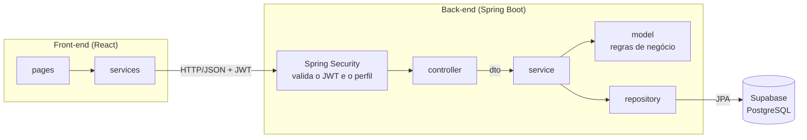

**Pacotes do back-end** (`br.pucminas.carrental`)

| Pacote | Responsabilidade |
|---|---|
| `controller` | Endpoints REST; obtêm o usuário autenticado a partir do token |
| `service` | Casos de uso e orquestração (transações, verificação de disponibilidade, montagem das respostas) |
| `model` | Entidades JPA **com comportamento**: as transições de status ficam nas próprias entidades (`aprovar`, `reprovar`, `modificar`, `cancelar`, `contratar`), e o `Banco` concede o crédito (`concederCredito`) |
| `repository` | Acesso a dados com Spring Data JPA |
| `dto` | Objetos de entrada e saída da API (*records*), com validação |
| `security` | Geração do token JWT |
| `config` | Spring Security: rotas por perfil, JWT, BCrypt e CORS |
| `exception` | Exceções de negócio e tratamento global de erros no formato `ProblemDetail` (RFC 9457) |

**Pacotes do front-end** (`frontend/src`): `routes` (rotas protegidas por perfil), `pages` (telas), `components` (componentes reutilizáveis), `contexts` (sessão), `services` (chamadas à API) e `utils` (formatadores).

**Padrões adotados:** Repository, Service Layer, DTO, modelo de domínio rico (regras nas entidades), tratamento centralizado de exceções.

**Decisões importantes**
- **Autenticação no próprio back-end (JWT), e não pelo Supabase Auth.** Assim o login faz parte do modelo e do código Spring (MVC), e o Supabase é usado apenas como banco PostgreSQL.
- **Data API do Supabase desativada.** Todo acesso aos dados passa pelo back-end; os dados pessoais (CPF, RG, renda) não ficam expostos por uma API pública.
- **Perfil no token.** O JWT carrega o perfil (`CLIENTE` ou `AGENTE`), convertido em *roles* do Spring Security. Cada perfil só acessa suas rotas, e o cliente só acessa os próprios dados.
- **Desempenho com banco remoto.** As listagens carregam os relacionamentos numa única consulta (`@EntityGraph` e *batch fetching*), evitando o problema N+1. Isso reduziu o tempo da lista de pedidos de ~1,7 s para ~0,55 s.

**Limitações conhecidas**
- O schema do banco é gerado pelo Hibernate (`ddl-auto=update`) e não por ferramentas de migração (Flyway/Liquibase).
- Não há tela de cadastro de agentes nem de automóveis; esses dados vêm do seed.
- O projeto roda localmente; não há deploy em produção.

### Diagramas UML

Os diagramas estão versionados em [`docs/diagramas`](docs/diagramas). A **v1** foi produzida antes da implementação, e a **v2** reflete o código final. As mudanças entre as versões estão registradas no [histórico de versões](docs/README.md#histórico-de-versões).

| Casos de Uso (v2) | Pacotes, visão lógica (v2) |
| :---: | :---: |
| 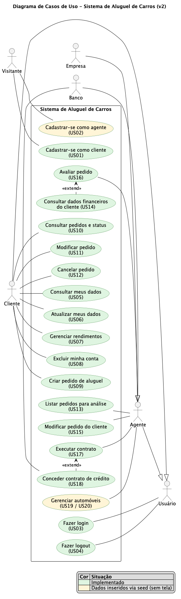 | 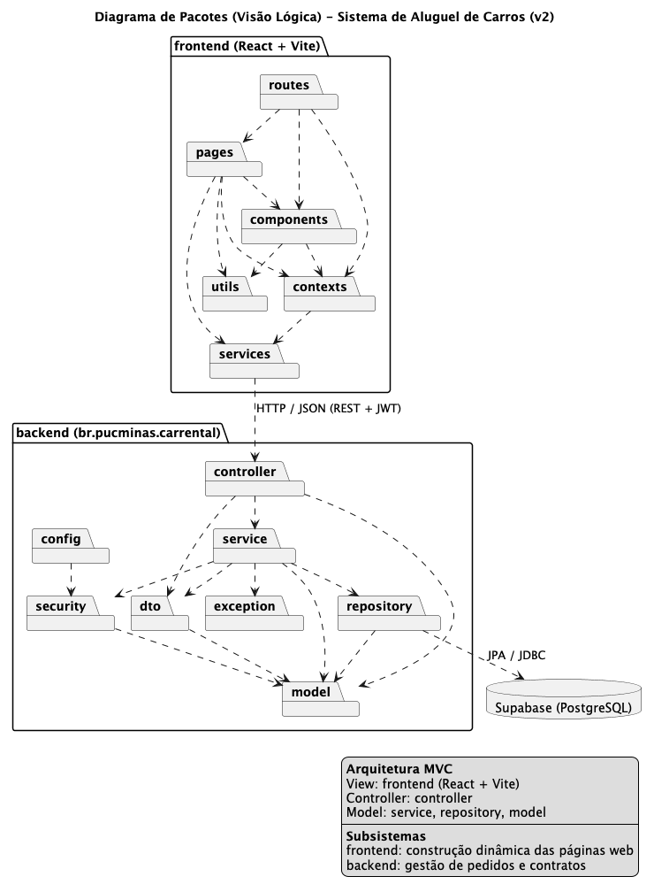 |

| Classes (v2) |
| :---: |
| 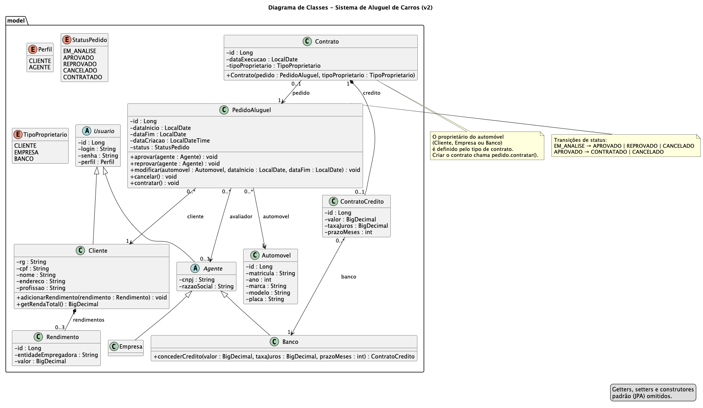 |

<details>
<summary><b>Ver diagramas da v1 (modelagem inicial)</b></summary>

| Casos de Uso (v1) | Classes (v1) | Pacotes (v1) |
| :---: | :---: | :---: |
| 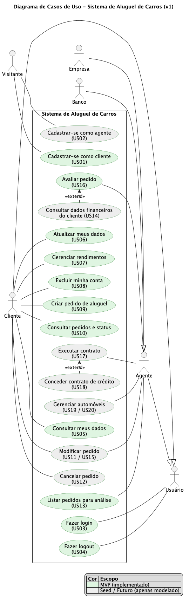 | 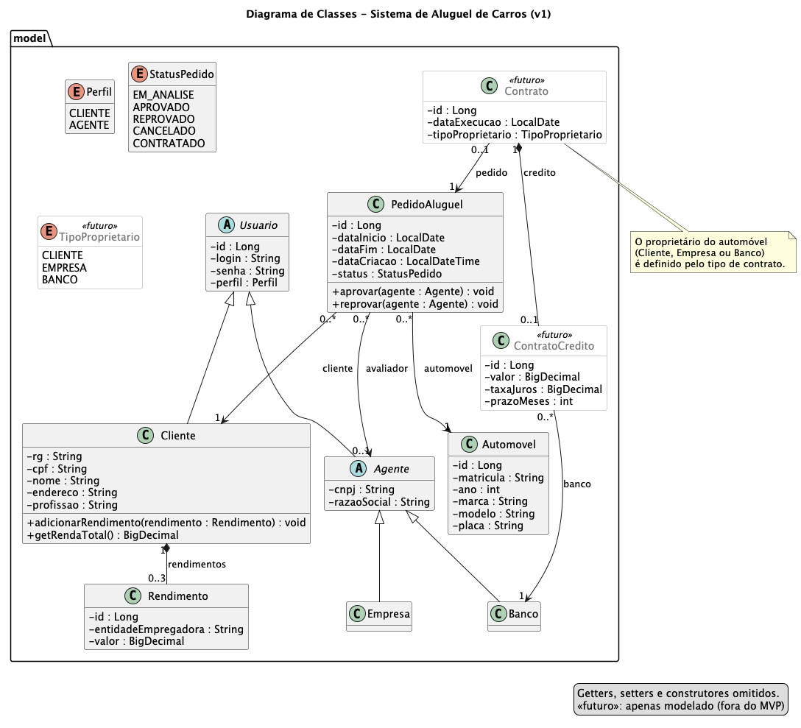 | 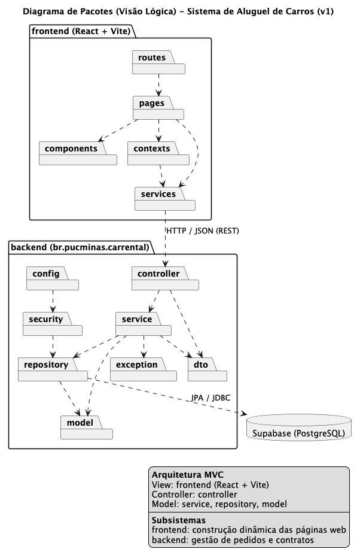 |

</details>

### API REST

Todas as rotas, exceto login e cadastro, exigem o cabeçalho `Authorization: Bearer <token>`.

| Método | Rota | Perfil | Descrição |
|---|---|---|---|
| `POST` | `/auth/cadastro` | Público | Cadastra um cliente (US01) |
| `POST` | `/auth/login` | Público | Autentica e retorna o token JWT (US03) |
| `GET` / `PUT` / `DELETE` | `/clientes/me` | Cliente | Consulta, atualiza ou exclui a própria conta (US05, US06, US08) |
| `POST` | `/clientes/me/rendimentos` | Cliente | Adiciona rendimento (US07) |
| `PUT` / `DELETE` | `/clientes/me/rendimentos/{id}` | Cliente | Edita ou remove rendimento (US07) |
| `GET` | `/automoveis` | Autenticado | Lista os automóveis |
| `POST` | `/pedidos` | Cliente | Cria pedido (US09) |
| `GET` | `/pedidos` e `/pedidos/{id}` | Cliente | Lista ou detalha os próprios pedidos (US10) |
| `PUT` | `/pedidos/{id}` | Cliente | Modifica pedido em análise (US11) |
| `POST` | `/pedidos/{id}/cancelar` | Cliente | Cancela pedido (US12) |
| `GET` | `/agente/pedidos?status=` | Agente | Lista pedidos por status (US13) |
| `GET` | `/agente/pedidos/{id}` | Agente | Detalhe do pedido com dados financeiros do cliente (US14) |
| `PUT` | `/agente/pedidos/{id}` | Agente | Modifica pedido em análise (US15) |
| `POST` | `/agente/pedidos/{id}/aprovar` e `/reprovar` | Agente | Avalia o pedido (US16) |
| `POST` | `/agente/pedidos/{id}/contrato` | Agente | Executa o contrato; crédito opcional, só para bancos (US17, US18) |

---

## 🔧 Instalação e Execução

### Pré-requisitos

* **Java JDK 25** (necessário para o back-end)
* **Node.js** 20 ou superior, com **npm** (necessário para o front-end)
* Uma conta no **[Supabase](https://supabase.com)** com um projeto criado (plano gratuito é suficiente)
* O **Maven** não precisa estar instalado: o projeto usa o Maven Wrapper (`./mvnw`)

---

### 🔑 Variáveis de Ambiente

Cada parte da aplicação tem um arquivo `.env.example`. Copie para `.env` e preencha. Os arquivos `.env` **não são versionados**.

#### 1. Back-end (`backend/.env`)

O Spring Boot lê esse arquivo automaticamente (`spring.config.import` em `application.properties`).

| Variável | Descrição | Exemplo |
| :--- | :--- | :--- |
| `DB_URL` | URL JDBC do *Session pooler* do Supabase | `jdbc:postgresql://aws-0-<regiao>.pooler.supabase.com:5432/postgres?sslmode=require` |
| `DB_USERNAME` | Usuário do banco (`postgres.` + ID do projeto) | `postgres.abcdefghijkl` |
| `DB_PASSWORD` | Senha do banco definida ao criar o projeto | `sua-senha` |
| `JWT_SECRET` | Chave para assinar os tokens (mínimo 32 caracteres) | gere com `openssl rand -base64 48` |
| `CORS_ALLOWED_ORIGINS` | (Opcional) Origens permitidas para o front-end | `http://localhost:5173` (padrão) |

#### 2. Front-end (`frontend/.env`)

| Variável | Descrição | Exemplo |
| :--- | :--- | :--- |
| `VITE_API_URL` | (Opcional) URL base da API | `http://localhost:8080` (padrão) |

---

### 📦 Instalação de Dependências

```bash
git clone https://github.com/sophiafernandesc/car-rental-system.git
cd car-rental-system
```

#### Front-end (React)

```bash
cd frontend
npm install
cd ..
```

#### Back-end (Spring Boot)

```bash
cd backend
cp .env.example .env   # preencha antes de continuar
./mvnw clean install
cd ..
```

> [!NOTE]
> O `install` roda o teste de inicialização, que sobe a aplicação e **conecta ao banco**. Por isso o `backend/.env` precisa estar preenchido antes. Para apenas compilar, use `./mvnw clean install -DskipTests`.

---

### 💾 Banco de Dados (Supabase)

1. No [Supabase](https://supabase.com), crie um projeto (região sugerida: São Paulo) e guarde a senha do banco.
2. Em **Connect → Connection string**, escolha o método **Session pooler**. A conexão direta usa IPv6, que muitas redes não suportam.
3. Separe a URI em `DB_URL`, `DB_USERNAME` e `DB_PASSWORD`, conforme a tabela acima.
4. Mantenha a **Data API desativada**: o sistema não a utiliza.

**Não é preciso criar tabelas.** Na primeira execução:
- o Hibernate cria o schema automaticamente (`ddl-auto=update`);
- o script [`data.sql`](backend/src/main/resources/data.sql) insere os **agentes** (uma empresa e um banco) e **15 automóveis**. O script é idempotente e pode rodar a cada inicialização sem duplicar dados.

---

### ⚡ Como Executar a Aplicação

Execute em **dois terminais**.

#### Terminal 1: Back-end (Spring Boot)

```bash
cd backend
./mvnw spring-boot:run
```
🚀 *A API estará disponível em **http://localhost:8080**.*

#### Terminal 2: Front-end (React, Vite)

```bash
cd frontend
npm run dev
```
🎨 *A aplicação estará disponível em **http://localhost:5173**.*

---

### 👥 Usuários de Teste

Os agentes são criados pelo seed. O cliente pode ser criado pela tela de cadastro.

| Perfil | Login | Senha |
|---|---|---|
| Agente: Empresa (Locadora Minas Ltda) | `locadora` | `agente123` |
| Agente: Banco (Banco Horizonte S.A.) | `banco` | `agente123` |

> [!WARNING]
> Credenciais apenas para uso local e demonstração.

---

## 📂 Estrutura de Pastas

```
.
├── README.md                         # 📘 Documentação principal
├── .gitignore                        # 🧹 Ignora .env, node_modules, etc.
│
├── docs/                             # 📚 Modelagem e documentação
│   ├── README.md                     # 🗂️ Organização e histórico de versões dos diagramas
│   ├── historias-usuario.md          # 📝 Histórias de usuário e escopo
│   ├── user-flow/user-flow.md        # 🧭 Fluxos de navegação (Mermaid)
│   ├── assets/                       # 🖼️ Logo do projeto
│   ├── prints/                       # 📸 Capturas de tela
│   └── diagramas/
│       ├── casos-de-uso/{v1,v2}/     # 🎭 Diagrama de casos de uso (.puml + .png)
│       ├── classes/{v1,v2}/          # 🧬 Diagrama de classes
│       └── pacotes/{v1,v2}/          # 📦 Diagrama de pacotes (visão lógica)
│
├── backend/                          # ☕ API Spring Boot
│   ├── .env.example                  # 🧩 Variáveis de ambiente (sem valores sensíveis)
│   ├── pom.xml                       # 🛠️ Build e dependências (Maven)
│   └── src/
│       ├── main/java/br/pucminas/carrental/
│       │   ├── controller/           # 🎮 Endpoints REST
│       │   ├── service/              # ⚙️ Casos de uso e regras de orquestração
│       │   ├── model/                # 🧬 Entidades JPA e regras de domínio
│       │   ├── repository/           # 🗄️ Repositórios Spring Data JPA
│       │   ├── dto/                  # ✉️ Records de entrada/saída da API
│       │   ├── security/             # 🛡️ Geração de token JWT
│       │   ├── config/               # 🔧 Spring Security, JWT, CORS
│       │   └── exception/            # 💥 Exceções e handler global
│       ├── main/resources/
│       │   ├── application.properties  # ⚙️ Configuração da aplicação
│       │   └── data.sql                # 🌱 Seed: agentes e automóveis
│       └── test/java/                # 🧪 Teste de inicialização da aplicação
│
└── frontend/                         # ⚛️ Aplicação React + Vite
    ├── .env.example                  # 🧩 Variáveis de ambiente
    ├── index.html
    ├── package.json
    ├── public/                       # 📂 Favicon
    └── src/
        ├── main.jsx                  # 🚪 Ponto de entrada
        ├── index.css                 # 🎨 Identidade visual (variáveis, glassmorphism)
        ├── routes/                   # 🧭 Rotas protegidas por perfil
        ├── pages/                    # 📄 Telas (login, cadastro, cliente/, agente/)
        ├── components/               # 🧱 Componentes reutilizáveis (Modal, PedidoCard, ...)
        ├── contexts/                 # 🔐 Sessão do usuário (AuthContext)
        ├── services/                 # 🔌 Chamadas à API
        ├── utils/                    # 🛠️ Formatadores (moeda, datas, CPF)
        └── assets/                   # 🖼️ Foto de fundo
```

---

## 🎥 Demonstração

### 🌐 Aplicação Web

| Login | Cadastro de cliente |
| :---: | :---: |
|  | 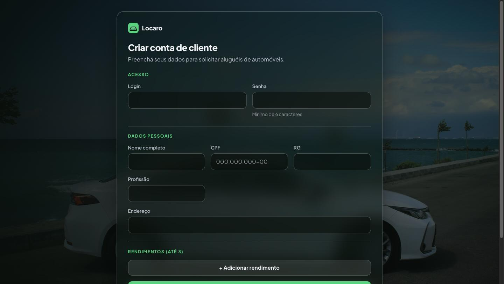 |
| **Meus pedidos (com filtros)** | **Detalhe do pedido (cliente)** |
| 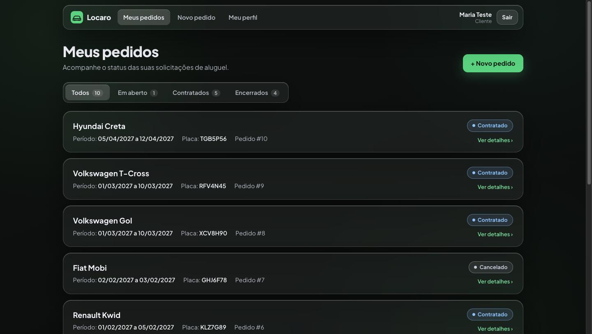 | 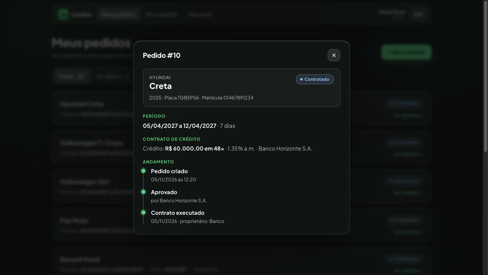 |
| **Novo pedido** | **Meu perfil e rendimentos** |
| 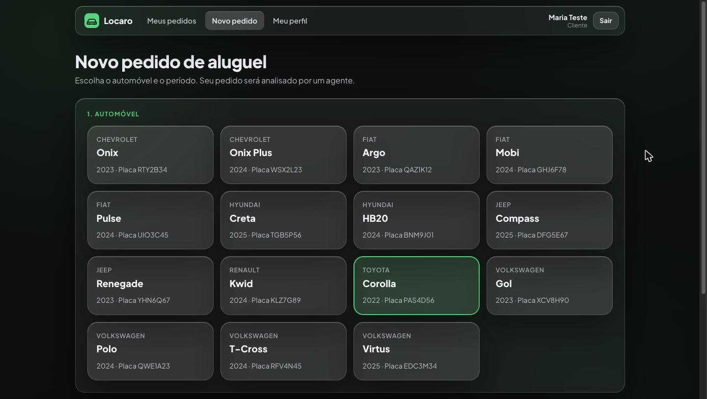 | 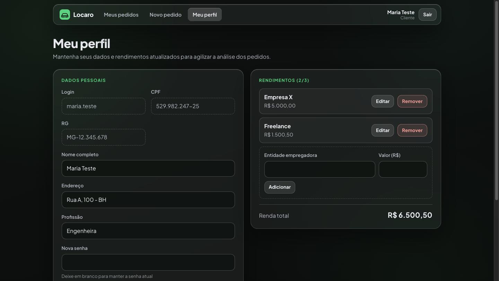 |
| **Avaliação de pedidos: aba Contratados (agente)** | **Detalhe do pedido com dados financeiros do cliente (agente)** |
| 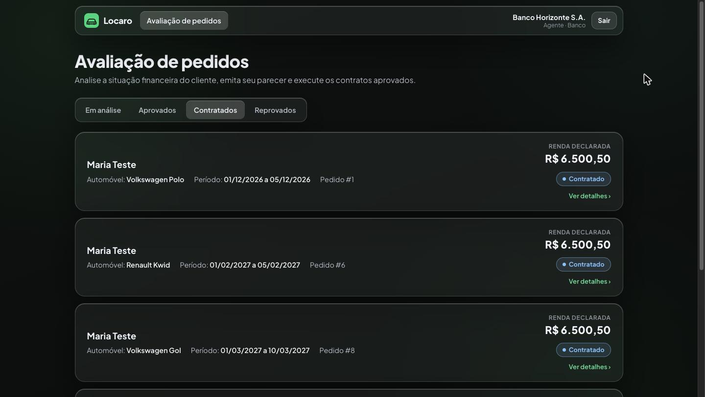 | 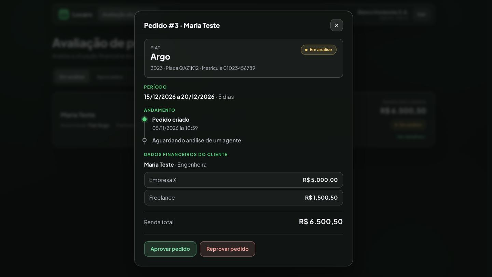 |

### 💻 Exemplo de uso da API (cURL)

```bash
# 1. Login do agente: retorna o token JWT
curl -X POST http://localhost:8080/auth/login \
     -H 'Content-Type: application/json' \
     -d '{"login": "banco", "senha": "agente123"}'

# 2. Pedidos aguardando análise
curl http://localhost:8080/agente/pedidos?status=EM_ANALISE \
     -H 'Authorization: Bearer <token>'
```

**Saída esperada (resumida):**
```json
[
  {
    "id": 3,
    "status": "EM_ANALISE",
    "dataInicio": "2026-12-15",
    "dataFim": "2026-12-20",
    "automovel": { "marca": "Fiat", "modelo": "Argo", "placa": "QAZ1K12" },
    "clienteNome": "Maria Teste",
    "clienteRendaTotal": 6500.50,
    "avaliador": null,
    "proprietario": null,
    "credito": null
  }
]
```

Erros seguem o formato `ProblemDetail`:
```json
{ "status": 422, "title": "Unprocessable Content", "detail": "Só é possível avaliar pedidos com status EM_ANALISE." }
```

---

## 🧪 Testes

### Teste automatizado

```bash
cd backend
./mvnw test
```
*Ferramenta: JUnit 5 + Spring Boot Test.* O teste `CarrentalApplicationTests` sobe o contexto completo da aplicação, incluindo a conexão com o banco, a criação do schema e o seed.

### Testes manuais

As funcionalidades foram validadas de ponta a ponta durante o desenvolvimento:
- **API (cURL):** cenários de sucesso e de erro de cada endpoint, por exemplo:
  - CPF inválido e 4º rendimento → `400`/`422`;
  - avaliar pedido fora de análise → `422`;
  - carro indisponível no período → `409`;
  - empresa concedendo crédito → `403`;
  - cliente acessando pedido de outro → `404`;
  - cliente acessando rotas de agente → `403`.
- **Navegador:** fluxos completos do cliente e do agente, incluindo layout em telas pequenas.

> [!NOTE]
> Testes unitários das regras de domínio e testes E2E não foram implementados nesta versão.

---

## 🔗 Documentações utilizadas

* 📖 **Back-end:** [Documentação oficial do **Spring Boot**](https://docs.spring.io/spring-boot/index.html)
* 📖 **Segurança:** [**Spring Security**: OAuth2 Resource Server (JWT)](https://docs.spring.io/spring-security/reference/servlet/oauth2/resource-server/jwt.html)
* 📖 **Persistência:** [**Spring Data JPA**](https://docs.spring.io/spring-data/jpa/reference/)
* 📖 **Banco de dados:** [Documentação do **Supabase**](https://supabase.com/docs)
* 📖 **Front-end:** [Documentação oficial do **React**](https://react.dev/reference/react)
* 📖 **Build tool:** [Guia do **Vite**](https://vite.dev/guide/)
* 📖 **Roteamento:** [**React Router**](https://reactrouter.com/home)
* 📖 **Modelagem:** [**PlantUML**](https://plantuml.com/pt/) e [**Mermaid**](https://mermaid.js.org/)
* 📖 **Padrão de commits:** [**Conventional Commits**](https://www.conventionalcommits.org/pt-br/v1.0.0/)
* 🖼️ **Foto de fundo:** [Unsplash](https://unsplash.com/photos/73XAgT8DOpo) (Unsplash License)

---

## 👥 Autores

Sophia da Costa Fernandes ([@sophiafernandesc](https://github.com/sophiafernandesc))
Ferramenta de IA: Claude + Codex (revisão)

---

## 🤝 Contribuição

1. Faça um `fork` do projeto.
2. Crie uma branch para sua feature (`git checkout -b feature/minha-feature`).
3. Faça commit das mudanças (`git commit -m 'feat: adiciona nova funcionalidade X'`), seguindo o padrão **[Conventional Commits](https://www.conventionalcommits.org/pt-br/v1.0.0/)**, usado em todo o histórico deste repositório.
4. Faça o `push` para a branch (`git push origin feature/minha-feature`).
5. Abra um **Pull Request**.

---

## 🙏 Agradecimentos

* [**Engenharia de Software PUC Minas**](https://www.instagram.com/engsoftwarepucminas/): pelo apoio institucional e pela estrutura acadêmica.
* [**Prof. Dr. João Paulo Aramuni**](https://github.com/joaopauloaramuni): pela proposta do laboratório, pelos ensinamentos e pelo template deste README.

---

## 📄 Licença

Projeto acadêmico desenvolvido para a disciplina de Desenvolvimento de Interfaces e Aplicações Web (DIAW) da PUC Minas.

---
