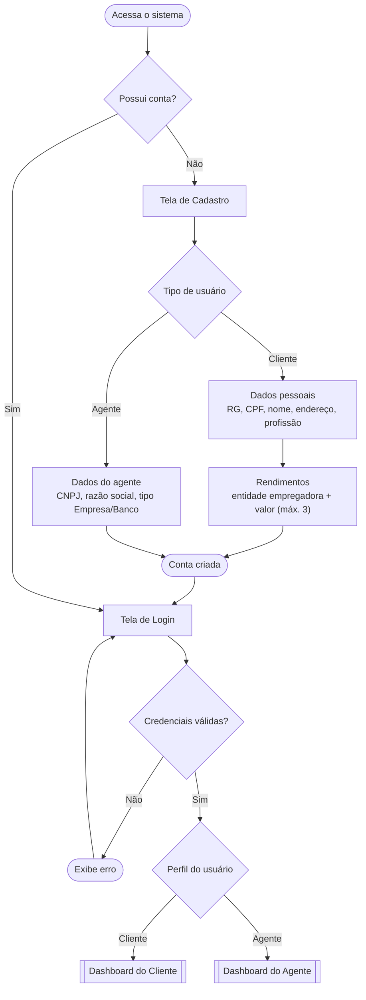
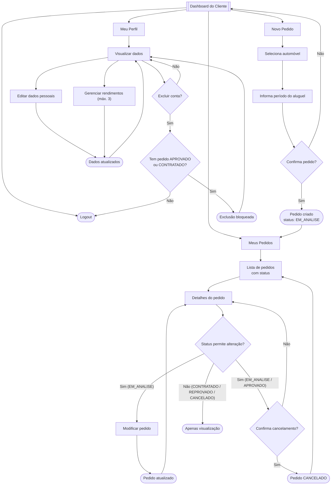
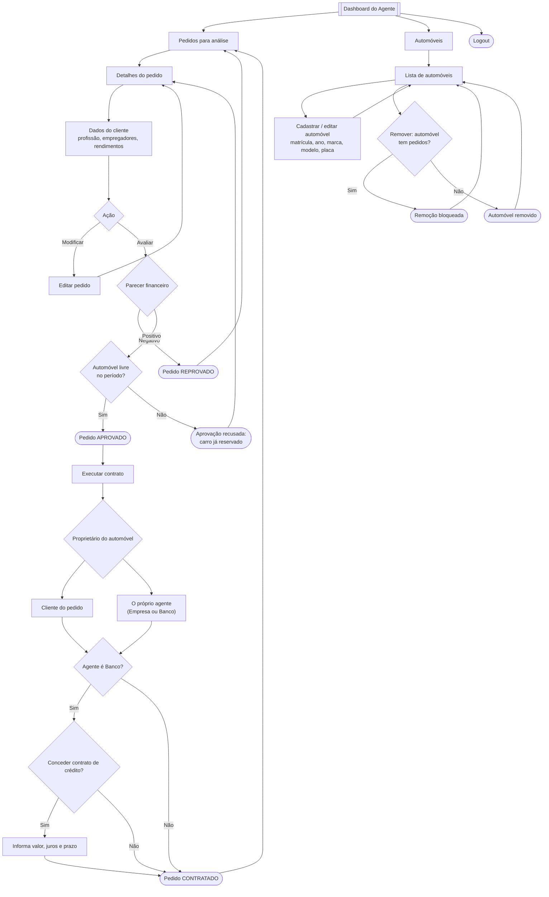
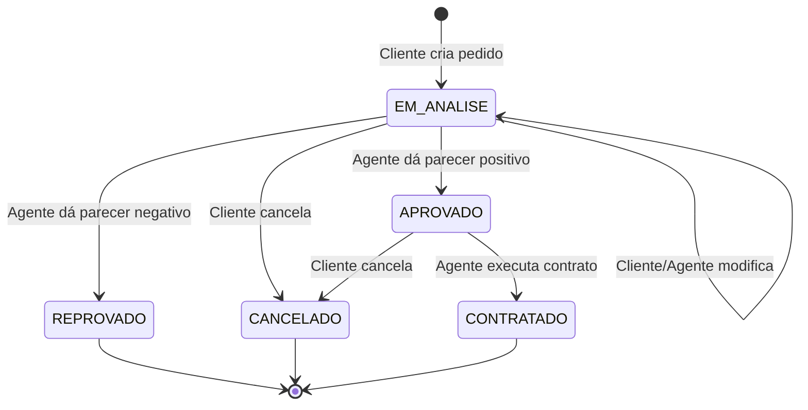

# User Flow  Sistema de Aluguel de Carros

> **Legenda:** retângulos = telas · losangos = decisões · arredondados = ações/resultados

---

## 1. Acesso ao sistema (autenticação)

O sistema só pode ser utilizado após cadastro prévio e login.

---

## 2. Fluxo do Cliente

O cliente pode **introduzir, modificar, consultar e cancelar** pedidos de aluguel, além de gerenciar seu perfil (CRUD de cliente).

---

## 3. Fluxo do Agente (Empresa / Banco)

Os agentes podem **modificar e avaliar** pedidos. Pedidos com parecer financeiro positivo seguem para **execução do contrato**. Apenas **bancos** podem conceder **contrato de crédito**.

---

## 4. Ciclo de vida do Pedido de Aluguel

Estados do pedido e quem dispara cada transição.

---

## Decisões adotadas

Pontos que o enunciado não define. Estão implementados conforme abaixo, mas **ainda não foram validados com o professor**.

- [x] **Cadastro de automóveis:** quem cadastra? (adotado: agentes)
- [x] **Cadastro de agentes:** autocadastro ou feito por um administrador? (adotado: autocadastro)
- [x] **Regras de alteração:** cliente pode modificar apenas pedidos `EM_ANALISE`? Pode cancelar após `APROVADO`? (adotado: modifica só em `EM_ANALISE`; cancela em `EM_ANALISE` ou `APROVADO`)
- [x] **Matrícula x placa:** interpretar "matrícula" como RENAVAM? (adotado: RENAVAM, 11 dígitos)
